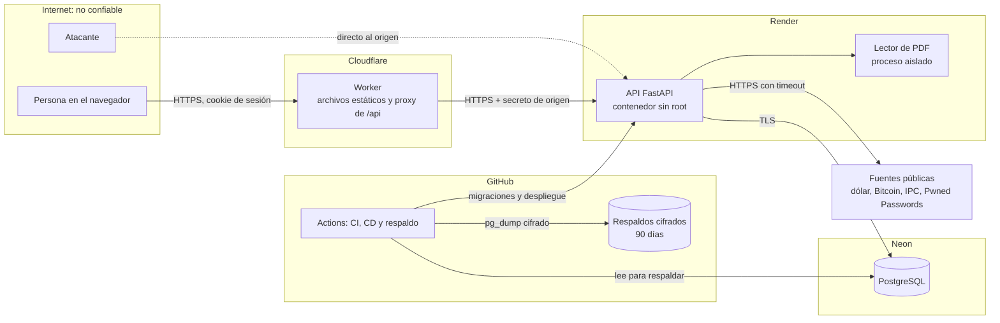

# Modelo de amenazas

* **Fecha:** 2026-11-22
* **Método:** STRIDE por elemento del diagrama de flujo de datos (Microsoft Threat Modeling), con las cuatro preguntas del Threat Modeling Manifesto: qué construimos, qué puede salir mal, qué hacemos al respecto y si lo hicimos bien.
* **Revisión:** con cada ADR que cambie un límite de confianza, y cada tres meses junto con el ensayo de restauración de los respaldos ([docs/respaldos.md](respaldos.md)).

Cada amenaza dice con qué se mitiga y dónde está la evidencia: un archivo, un test o un ADR. Lo que no se mitiga figura como riesgo aceptado, con su motivo.

## Qué construimos

Rinde es una app de finanzas personales. Cada persona carga sus cuentas, movimientos, presupuestos e importaciones de su banco. No hay datos compartidos entre personas, salvo las cotizaciones y el IPC, que son públicos y los mismos para todos.

Límites de confianza: entre internet y Cloudflare, entre Cloudflare y Render (el origen de Render es alcanzable desde internet), entre la API y la base, entre la API y cada tercero, y entre GitHub Actions y producción.

### Activos

| Activo | Por qué importa |
| --- | --- |
| Datos financieros de cada persona | Son privados; una fuga o un cambio ajeno es el peor resultado posible |
| Credenciales: contraseña, código de recuperación, token de sesión | Dan acceso a todo lo anterior |
| Integridad de los montos y del historial | Un monto alterado sin rastro rompe la confianza en la app |
| Secretos de despliegue: URL de la base, secreto de origen, tokens de Cloudflare y Render, clave de la GitHub App | Dan control de producción |
| Clave privada de los respaldos | Abre cualquier respaldo; se guarda fuera del repositorio y fuera de GitHub |
| Disponibilidad | Importa, pero menos que lo anterior: Rinde no mueve dinero |

### Quién puede atacar

* **Anónimo en internet:** prueba contraseñas, escanea el origen, manda archivos armados.
* **Persona con cuenta propia, incluida una demo:** intenta llegar a datos de otra cambiando identificadores (IDOR).
* **Sitio malicioso** que la persona visita con la sesión abierta: CSRF, clickjacking.
* **Tercero comprometido:** una fuente de cotizaciones que responde datos falsos o una dependencia publicada con código malicioso.
* **Quien obtenga un secreto** de despliegue o acceso a la cuenta de GitHub.

Fuera del modelo: un proveedor de infraestructura comprometido (Cloudflare, Render, Neon, GitHub) y el dispositivo de la persona comprometido.

## Qué puede salir mal y qué hacemos

S: suplantación. T: manipulación. R: repudio. I: revelación de información. D: denegación de servicio. E: elevación de privilegios.

### Navegador y frontend

| | Amenaza | Control | Evidencia |
| --- | --- | --- | --- |
| T, E | XSS: un script ajeno lee datos o actúa con la sesión | CSP `script-src 'self'` sin `unsafe-inline` ni `unsafe-eval`; React escapa por defecto; la cookie es `HttpOnly` | `frontend/public/_headers`, [ADR-0010](adr/0010-excepciones-de-la-csp.md) |
| S | CSRF: otro sitio dispara una acción con la cookie | `SameSite=Strict` y encabezado `X-Requested-With` obligatorio en todo lo que cambia estado; sin CORS | `shared/api/csrf.py`; `tests/api/test_csrf.py` recorre todas las rutas |
| T | Clickjacking | `frame-ancestors 'none'` y `X-Frame-Options: DENY` | `frontend/public/_headers` |
| I | Datos financieros en una caché compartida | El Worker agrega `Cache-Control: no-store` a toda respuesta de la API | `frontend/worker/proxy.ts` |
| I | Degradación a HTTP | HSTS de un año y cookie con prefijo `__Host-` (exige `Secure`) | `_headers`, `auth/api/cookies.py` |

### Del navegador a la API, por el Worker

| | Amenaza | Control | Evidencia |
| --- | --- | --- | --- |
| S | Llamar directo a Render e inventar la dirección de origen para esquivar los límites | La API rechaza todo pedido sin el secreto que agrega el Worker, comparado en tiempo constante; se aceptan dos secretos para rotar sin cortar | `shared/api/origin.py`, `tests/api/test_origin.py`, [ADR-0032](adr/0032-secreto-entre-worker-y-api.md) |
| I | El secreto de origen se filtra | Es un secreto del Worker (`wrangler secret`) y una variable de entorno de Render, nunca está en el repositorio; el escaneo de secretos corre en cada cambio | `frontend/worker/index.ts`, job "Escaneo de secretos" en `ci.yml` |

### API: autenticación y sesiones

| | Amenaza | Control | Evidencia |
| --- | --- | --- | --- |
| S | Fuerza bruta contra una cuenta | 10 fallas en 15 minutos bloquean la cuenta (NIST SP 800-63B-4) | `auth/application/sessions.py` |
| S | Rociado de contraseñas contra muchas cuentas | 30 fallas por dirección en 15 minutos; registro y demo también limitados por dirección | `auth/application/rate_limits.py`, `tests/api/test_rate_limits.py` |
| S | Contraseñas débiles o filtradas | Mínimo de 15 caracteres y consulta a Pwned Passwords por k-anonimato, con relleno | `auth/domain/password_policy.py`, `auth/infrastructure/pwned_passwords.py`, [ADR-0007](adr/0007-autenticacion.md) |
| I | Saber si una cuenta existe | Mismo error y mismo trabajo (una verificación Argon2) exista o no | `auth/application/login.py`, `tests/unit/auth/test_use_cases.py` |
| I | Robo de la base revela contraseñas o sesiones | Argon2id con los parámetros de OWASP; la base guarda el SHA-256 del token, nunca el token | `auth/infrastructure/argon2_hasher.py`, `auth/application/sessions.py` |
| S | Sesión robada o vieja | Token opaco de 256 bits, vence a los 30 días, se revoca al cerrar sesión y todas al recuperar la cuenta | `auth/application/session_access.py`, `auth/application/recover.py` |
| E | Borrar una cuenta con una sesión ajena olvidada abierta | El borrado pide la contraseña, con los mismos topes que el inicio de sesión | `auth/application/delete_account.py`, [ADR-0034](adr/0034-borrar-la-cuenta-y-exportar-los-datos.md) |
| R | Un ataque pasa sin dejar rastro | Registro de eventos de seguridad con el vocabulario de OWASP | `shared/infrastructure/security_log.py`, [ADR-0035](adr/0035-registro-de-eventos-de-seguridad.md) |

### API: datos de cada persona

| | Amenaza | Control | Evidencia |
| --- | --- | --- | --- |
| E, I | IDOR: leer o cambiar recursos de otra persona con su identificador | Toda consulta filtra por el usuario de la sesión; un recurso ajeno responde 404, igual que uno inexistente | `tests/api/test_authorization.py` recorre todas las rutas, [ADR-0009](adr/0009-modelo-de-cuentas.md) |
| T | Montos mal calculados o redondeados | `Decimal` y `NUMERIC`, nunca `float`; el frontend no hace cuentas | [ADR-0002](adr/0002-representacion-de-dinero-y-cotizaciones.md), `shared/domain/money.py` |
| T | Un reintento duplica un movimiento | `Idempotency-Key` en los POST que crean dinero | `transactions/api/router.py`, `installments.py`, `recurring.py`, `budgets/api/router.py` |
| R | Un cambio en un movimiento no deja rastro | Log de auditoría append-only, con triggers que impiden modificarlo o borrarlo | migraciones `0004`, `0005` y `0018` |
| T | Inyección SQL | Solo consultas parametrizadas de SQLAlchemy; CodeQL en cada cambio | `codeql.yml` |
| I | Una respuesta de error revela detalles internos | Errores como códigos estables, sin trazas ni mensajes traducidos | `shared/api/errors.py` |
| I | Exportar los datos deja una copia en el camino | La descarga va con `Cache-Control: no-store` | `privacy/api/router.py`, [ADR-0034](adr/0034-borrar-la-cuenta-y-exportar-los-datos.md) |

### API: archivos importados

| | Amenaza | Control | Evidencia |
| --- | --- | --- | --- |
| D | Un cuerpo enorme agota la memoria | Tope del cuerpo, contado byte a byte aunque falte `Content-Length` | `shared/api/body_limit.py` |
| D, E | Un PDF armado (bomba de descompresión, parser vulnerable) tumba o toma el servidor | Se lee en un proceso aparte, con tope de memoria, CPU y tiempo | [ADR-0031](adr/0031-pdf-en-proceso-aislado.md), `tests/unit/imports/test_sandbox.py` |
| T | Un CSV o un PDF con datos malformados | Cada línea se valida; lo que no se entiende se informa, no se adivina; nada se guarda sin la vista previa | [ADR-0023](adr/0023-modelo-de-importacion.md) |

### Terceros: cotizaciones, IPC y Pwned Passwords

| | Amenaza | Control | Evidencia |
| --- | --- | --- | --- |
| T | Una fuente responde datos falsos o malformados | La respuesta se valida como entrada no confiable; varias fuentes en cadena | `rates/infrastructure/sources.py`, [ADR-0016](adr/0016-fuentes-de-cotizaciones.md) |
| D | Una fuente no responde y cuelga la API | Timeout, reintento con espera exponencial y la siguiente fuente de la cadena | `shared/infrastructure/http.py`, `rates/application/providers.py` |

### Base de datos

| | Amenaza | Control | Evidencia |
| --- | --- | --- | --- |
| T | Datos inconsistentes por un error del código | Restricciones en la base (FK, CHECK, UNIQUE) y operaciones de varias filas en una transacción | migraciones en `backend/migrations` |
| I | Tráfico interceptado | Neon exige TLS en toda conexión | documentación de Neon |
| D | Pérdida de la base | Respaldo diario fuera de Neon, cifrado con una clave pública, restaurado en una base vacía antes de guardarse; ensayo de restauración cada tres meses | [ADR-0033](adr/0033-respaldos-de-la-base.md), [docs/respaldos.md](respaldos.md) |

### CI/CD y cadena de suministro

| | Amenaza | Control | Evidencia |
| --- | --- | --- | --- |
| T | Una acción de terceros cambia de código | Fijadas por SHA completo; Dependabot las actualiza | `.github/workflows` |
| E | Un workflow con más permisos de los necesarios | `contents: read` por defecto y permisos por job | `.github/workflows` |
| E | Inyección de comandos con datos del evento | Los datos del evento pasan por `env:`, nunca dentro de `run:` | `.github/workflows` |
| T | Una dependencia con una vulnerabilidad conocida | Auditoría diaria de Python, npm y las imágenes; si aparece algo, se abre un issue solo; Trivy frena el despliegue con hallazgos altos | `auditoria.yml`, `cd.yml` |
| I | Un secreto subido al repositorio | Escaneo de secretos con gitleaks en cada cambio, y protección contra pushes de GitHub | `ci.yml` |
| T | Un cambio entra sin revisión ni pruebas | `main` protegida: solo por PR con la CI en verde; Dependabot integra solo parches | [ADR-0004](adr/0004-estrategia-de-ramas.md), [ADR-0015](adr/0015-auto-merge-de-dependabot.md) |
| I | Un respaldo descargado por quien no debe | Cifrado con GPG; la clave privada no está en GitHub | [ADR-0033](adr/0033-respaldos-de-la-base.md) |

## Riesgos aceptados y pendientes

Ordenados por prioridad. Cada uno dice por qué se acepta hoy y qué lo cerraría.

1. **La API usa el mismo rol de la base que las migraciones.** El CD corre `alembic upgrade head` con `RINDE_DATABASE_URL`, el mismo secreto que usa la API. Ese rol puede cambiar el esquema y hasta borrar los triggers que hacen append-only la auditoría, así que una inyección SQL o un robo de ese secreto alcanzarían más de lo necesario. **Lo cierra:** un rol solo para migraciones y otro para la API, con permisos de lectura y escritura sobre las tablas y nada más.
2. **No hay alertas.** El registro de seguridad existe, pero alguien tiene que mirarlo, y Render lo guarda 7 días en el plan gratuito ([ADR-0035](adr/0035-registro-de-eventos-de-seguridad.md)). **Lo cierra:** reenviar el registro a un recolector con reglas de alerta.
3. **La contraseña es el único factor.** NIST lo admite con 15 caracteres, la consulta de filtradas y el límite de intentos, que están. **Lo cierra:** TOTP opcional, que es el próximo ítem del roadmap.
4. **Sin límite de pedidos para quien ya tiene sesión.** Una cuenta propia puede pedir mucho. Los topes de cuerpo y de PDF acotan lo más caro, y Cloudflare filtra el volumen. **Lo cierra:** un límite por usuario en los endpoints costosos.
5. **Si Pwned Passwords no responde, se omite el control** y queda en el registro. Se prefiere no frenar un registro por un tercero; la contraseña igual cumple los 15 caracteres. **Lo cierra:** nada por ahora, es una decisión.
6. **Una sola instancia gratuita en Render.** Un ataque de volumen que pase Cloudflare la satura, y se apaga sin tráfico ([ADR-0005](adr/0005-hosting-gratuito.md)). Se acepta porque Rinde no mueve dinero.
7. **Sin SBOM ni firma de las imágenes.** Las imágenes se escanean, pero no se publica la lista de componentes ni se firma lo que se despliega. **Lo cierra:** generar el SBOM en el CD y firmar con Sigstore.
8. **La clave privada de los respaldos depende de una sola persona.** Está en su gestor de contraseñas. Si la pierde, los respaldos no se abren. **Lo cierra:** una segunda copia offline, guardada en otro lugar.

## Cómo sabemos que funciona

* Los controles de la API tienen tests que fallan si se rompen. Los de alcance global (CSRF, IDOR y control de origen) recorren todas las rutas en lugar de una lista escrita a mano.
* CodeQL, la auditoría de dependencias, Trivy y gitleaks corren solos.
* Los respaldos se restauran antes de guardarse, y el ensayo trimestral prueba la guía completa.
* Las vulnerabilidades se reportan en privado según [SECURITY.md](../SECURITY.md).
